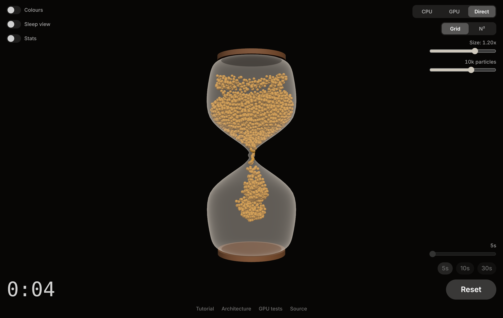
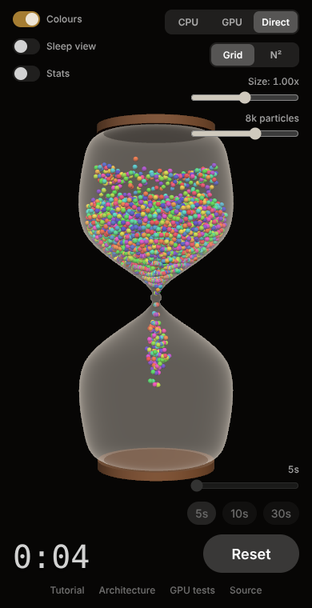

# Shifting Sands (web)

   

An hourglass timer for the browser with a real-time granular physics
simulation. Golden sand grains pour through a glass hourglass built
entirely from code. The physics runs in WebGPU compute shaders and the
picture is drawn with three.js.

This is the web version of the iOS app
[shiftingsands](https://github.com/pcwilliams/shiftingsands). The hourglass
shape, the physics kernel, the constants and the controls are ported from
it.

**Live:** https://pcwilliams.github.io/shiftingsands-web/



## Features

- **Three physics modes**, mirroring the app's CPU / GPU / Metal:
  - **CPU**: JavaScript on the main thread, up to 2,000 grains.
  - **GPU**: WebGPU compute, with the positions read back to JavaScript
    every frame, up to 20,000 grains.
  - **Direct**: WebGPU compute feeding the draw call on the GPU. No grain
    ever visits JavaScript. Up to 200,000 grains.
- **Three ways to find collisions** on the GPU, switchable while it runs:
  - **N²**: every grain tests every other grain, exactly as the app does.
  - **Grid**: a spatial hash, so each grain only looks at its neighbours.
    It gives the same physics as N², only faster.
  - **Sorted**: the same spatial hash, but every substep the grains are
    counting-sorted by cell, so each cell is one run of memory and the
    GPU's threads work through the pile cell by cell. It's here to compare
    against Grid on real hardware.
- **A glass that fits the sand**: the neck is rebuilt for each grain size
  so that one grain just fits through.
- **A real flip**: gravity turns with the glass during the 1.2 second
  flip.
- Size, count, duration (5 to 30 seconds), and a random-colour mode.
  Everything is remembered per mode.
- **Sleep view**: tints the grains the GPU has put to sleep, so you can
  watch the pile settle.
- **Stats**: frame time, substeps, how much collision searching each
  frame costs, triangles and GPU memory, plus a chart of physics
  and drawing time per frame across the whole run, with the worst of each.



## Browser support

The GPU and Direct modes need WebGPU. Chrome and Edge have had it for a
while, Safari has it from version 26, and Firefox has it on Windows and
macOS. Without WebGPU the page falls back to the CPU mode, drawn with
WebGL 2, and says so.

## Using it

- **Start** flips the hourglass and starts the countdown. **Reset** puts
  fresh sand at the bottom. Space or Enter does the same.
- Changing the count, size or colours respawns the sand when the
  hourglass is at rest. Changing mode mid-run restarts in the new mode.
- **Grid / Sorted / N²** switches live, so you can watch the frame time
  change with the same sand on screen. The Stats chart covers a whole run,
  so one run with each is a fair comparison.

### URL parameters

These are the web's launch arguments. They override the saved settings.

| Parameter | Example | Effect |
|---|---|---|
| `mode` | `?mode=direct` | `cpu`, `gpu` or `direct` (`metal` also works) |
| `count` | `?count=50000` | Number of grains |
| `size` | `?size=1.3` | Size multiplier, 0.5 to 1.5 |
| `duration` | `?duration=30` | Timer length in seconds, 5 to 30 |
| `broadphase` | `?broadphase=sorted` | `grid`, `sorted` or `brute` (N²) |
| `colors` | `?colors` | A random colour per grain |
| `stats` | `?stats` | Show the stats readout |
| `autostart` | `?autostart` | Flip two seconds after loading |
| `test` | `?test` | 10 second run, then a summary on `window.shiftingSands.results` |
| `seed` | `?seed=4` | Make the spawn and colours repeatable |

## Run it locally

There is no build step. ES modules don't load from `file://`, so serve
the folder:

```bash
python3 -m http.server 8000
# then open http://localhost:8000/
```

## Tests

```bash
node --test
```

81 tests cover everything that isn't pixels: the glass profile, spawn
packing, the CPU physics (ported from the app's `CPUPhysicsTests.swift`),
both spatial hashes, the timer, settings and URL parsing. They need Node 20
or later and have no dependencies.

Node can't run WebGPU, so the compute shaders have their own page:
open [the GPU test page](https://pcwilliams.github.io/shiftingsands-web/gpu-tests.html) in a WebGPU browser. It runs
ports of the app's `GPUPhysicsTests.swift` on your GPU, once per
collision search, checks that all three searches produce the same step,
and reads back the sort's own buffers to check them.

## How it works

- [Tutorial](https://pcwilliams.github.io/shiftingsands-web/tutorial.html):
  how the rendering and the GPU physics work, step by step, for someone
  coming from Metal.
- [Architecture](https://pcwilliams.github.io/shiftingsands-web/architecture.html):
  the diagrams.
- [`CLAUDE.md`](CLAUDE.md) is the developer reference.

## Project structure

```
shiftingsands-web/
├── index.html              # import map, canvas, controls
├── gpu-tests.html          # in-browser tests for the compute shaders
├── css/style.css
├── js/
│   ├── main.js             # bootstrap, controller, frame loop
│   ├── models/             # pure: no DOM, no three.js (unit-tested)
│   │   ├── hourglassProfile.js   # glass curve, surface of revolution
│   │   ├── packing.js            # grain radius, hex-packed spawn, colours
│   │   ├── physicsConfig.js      # constants, per-mode limits, substeps
│   │   ├── grid.js               # spatial hash and sorted grid (reference versions)
│   │   └── perfHistory.js        # per-frame timings for the Stats chart
│   ├── physics/
│   │   ├── cpuSimulation.js      # CPU physics
│   │   ├── shaders.js            # WGSL compute kernels
│   │   └── gpuPhysics.js         # raw WebGPU engine
│   ├── scene/hourglassScene.js   # three.js scene, instanced sand
│   ├── services/           # settings store, timer, URL parameters
│   ├── ui/                 # DOM controls, Stats chart
│   └── dev/gpuSelfTest.js  # tests behind gpu-tests.html
├── tests/                  # node --test
├── docs/                   # screenshots
└── .github/workflows/pages.yml   # test, then deploy to GitHub Pages
```

## Known behaviour

The physics is a faithful port, including one thing worth knowing: the
sand is not metered to the timer. At the 5 second setting the upper
chamber empties in about 1.5 seconds; at 30 seconds it takes anywhere
from 5 seconds to more than 30, depending on mode and count. The countdown and the
sand are independent, as they are in the app's code. The tutorial
explains why and what would fix it.

## Deploying

Pushing to `main` runs the tests and publishes to GitHub Pages. One
setting has to be made by hand, once: in the repository's Settings, under
Pages, set the source to **GitHub Actions**.
